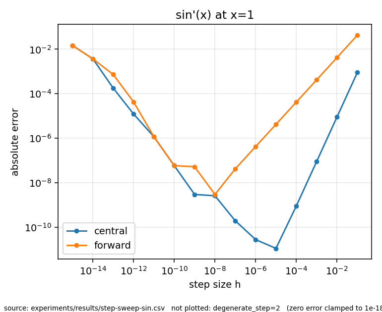

# C++ Derivative Explorer

A small, tested C++17 command-line tool that compares **forward** and **central finite-difference** derivative estimates against known analytical derivatives, quantifies the error across step sizes, and exports reproducible CSV results with a plotting script.

The point of the project is the engineering around the numbers: explicit domain and error policies, honest handling of invalid/non-finite results, tolerance-justified tests, sanitizer-clean builds on two compilers, and reproducible experiments.

> Independent educational project. Not endorsed by any organisation.

## Example result

`sin'(x)` at x=1, h from 1e-1 to 1e-16 (`experiments/results/`, regenerate with `experiments/step-sweep.sh`):



Measured on this repo's sweep (GCC 15.2, Release, double precision):

| function | method | smallest error | at h |
|----------|--------|---------------:|-----:|
| sin, x=1 | forward | 2.97e-09 | 1e-8 |
| sin, x=1 | central | 1.11e-11 | 1e-5 |
| exp, x=0.5 | forward | 2.21e-08 | 1e-8 |
| exp, x=0.5 | central | 1.93e-11 | 1e-5 |

Truncation error dominates for large h; floating-point cancellation dominates below the optimum. The optima agree with the usual analysis (~√ε for forward, ~ε^(1/3) for central). These numbers are specific to the functions, points and toolchain above.

## Build, test, run

Requirements: CMake ≥ 3.20, a C++17 compiler (GCC or Clang), Ninja or Make, network access on first configure (GoogleTest v1.17.0 is fetched and SHA-256 pinned). Python 3 + matplotlib for plots.

```bash
cmake -S . -B build/release -G Ninja -DCMAKE_BUILD_TYPE=Release -DBUILD_TESTING=ON
cmake --build build/release
ctest --test-dir build/release --output-on-failure

build/release/derivative-explorer --list-functions
build/release/derivative-explorer --function x2 --x 3 --method central --step 0.01
build/release/derivative-explorer --function sin --x 1 --methods forward,central \
    --log-steps 1:16 --csv results.csv
python3 scripts/plot_results.py results.csv results.png
```

Presets (`debug`, `release`, `asan`) are in `CMakePresets.json`. Sanitizers: `-DDE_ENABLE_SANITIZERS=ON`.

### CLI

| option | meaning |
|---|---|
| `--list-functions` | list `x2, x3, sin, cos, exp, log` |
| `--function ID` | function to differentiate |
| `--x LIST` | comma-separated points |
| `--method/--methods` | `forward`, `central` (default both) |
| `--step/--steps LIST` | positive step sizes |
| `--log-steps A:B[:N]` | log-spaced h from 10^-A to 10^-B |
| `--csv PATH` | export results |

Exit codes: 0 ok, 1 CSV I/O failure, 2 usage error, 70 internal error.

## Design

```
CLI (main.cpp) → function registry → comparison engine → derivative methods → metrics
                                              └→ records → terminal / CSV writer → plot_results.py
```

- **Function model** (`function.*`): id, value, analytical derivative, explicit domain predicate. Radians.
- **Methods** (`derivative_methods.*`): a method evaluates exactly its stencil points; it never alters h or falls back to another method.
- **Errors are data, not exceptions**: each result carries a status: `ok | invalid_step | invalid_domain | non_finite`. One bad configuration in a sweep is recorded, not fatal.
- **Metrics**: absolute error always; relative error only when |reference| ≥ 1e-12, otherwise empty.
- **CSV (schema_version 1)**: `schema_version,function_id,method_id,x,h,estimate,reference,absolute_error,relative_error,status`; numbers as `%.17g`; non-finite values are written as empty fields, with the reason in `status`.

More detail: `docs/architecture.md`, `docs/requirements.md`, `docs/test-plan.md`, `docs/decisions/ADR-001-stack.md`.

## Testing

29 CTest entries: GoogleTest unit tests (functions, methods, metrics, comparison, CSV), a CLI integration test (exit codes, CSV shape, unwritable path), and plot-script input validation. Tolerances are justified in comments and `docs/test-plan.md`; convergence-order tests only assert in the truncation-dominated range.

## Known limitations

- Backward differences, higher-order stencils, multivariable derivatives, Clad and ROOT integration are **not implemented** (optional extensions in the blueprint).
- Benchmarks are not implemented; `docs/benchmark-methodology.md` is a plan only.
- Only double precision and six built-in functions; no user expression parsing.
- Floating-point results are approximate and platform-dependent in the last bits.
- No LICENSE file yet (owner has not chosen one).
